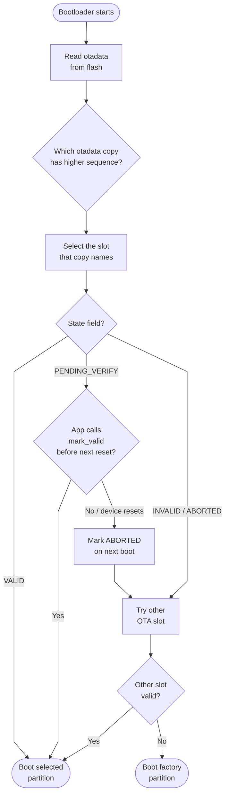

import TawkWidget from '../../../../components/TawkWidget.astro';
import UniversalContentContributors from '../../../../components/UniversalContentContributors.astro';
import InArticleAd from '../../../../components/InArticleAd.astro';
import Copyright from '../../../../components/Copyright.astro';
import BionicText from '../../../../components/BionicText.astro';
import TailwindWrapper from '../../../../components/TailwindWrapper.jsx';
import { Tabs, TabItem } from '@astrojs/starlight/components';
import { Card, CardGrid, Badge, Steps, LinkButton, FileTree } from '@astrojs/starlight/components';

<UniversalContentContributors 
  contributors={frontmatter.contributors}
/>


import EmbeddedProgrammingEsp32Comments from '../../../../components/embedded-programming-esp32/EmbeddedProgrammingEsp32Comments.astro';

A sensor node is closed in a box on a roof, and you find a mistake in its firmware. Without a way to update it from a distance, someone must climb up with a laptop and a USB cable, for every node. An OTA (over-the-air) update sends new firmware over Wi-Fi. The danger is an update that does not work: it could leave the node dead and out of reach. So the ESP32 keeps the old firmware in a second place in flash and goes back to it when the new one fails. In this lesson you build that, and you also see how flash encryption and secure boot v2 stop other people from reading your firmware or loading their own. #ESP32 #OTA #Security

## What We Are Building

<Card title="Remotely Updateable Sensor Node" icon="star">
A sensor node that checks for firmware updates from an HTTP server on your local network. When a new firmware binary is available, the ESP32 downloads it, writes it to the inactive OTA partition, verifies the image, and reboots into the new firmware. If the new firmware fails a self-test, the bootloader rolls back to the previous working version. The lesson also walks through enabling flash encryption in development mode and secure boot v2.
</Card>

**Project specifications:**

| Parameter | Value |
|-----------|-------|
| MCU | ESP32 DevKitC |
| OTA Method | HTTP pull (ESP32 polls a server for new firmware) |
| Partition Table | Custom: factory + ota_0 + ota_1 + nvs + otadata |
| Firmware Hosting | Python HTTP server on your development machine |
| Rollback | Automatic on failed self-test (app_valid flag) |
| Flash Encryption | AES-256, development mode (reflashable) |
| Secure Boot | v2 (RSA-PSS signature verification) |
| Version Tracking | Firmware version string in app description |
| Self-Test | Wi-Fi connect within 15 seconds + sensor read |
| Sensor | The DHT22 from the HTTP server lesson, or any sensor |

### Bill of Materials

| Ref | Component | Quantity | Notes |
|-----|-----------|----------|-------|
| U1 | ESP32 DevKitC | 1 | The board you have used so far |
| S1 | DHT22 or any sensor | 1 | Read by the self-test |
| | Computer on same Wi-Fi network | 1 | Hosts firmware binary via Python HTTP server |
| | Breadboard + jumper wires | 1 set | |

## OTA Partition Scheme

<InArticleAd />


A program cannot safely overwrite itself while it runs, and a power cut half way would leave half a program. So the flash is divided into partitions, fixed regions with one purpose each, and two of them (the OTA slots) can each hold a complete copy of the firmware, an image. While one slot runs, the new version is written to the other, as a new bridge is built beside the old one while traffic still crosses. The bootloader, the small program that runs first after every reset, reads a record called `otadata` to choose which slot to start, and goes back to the old slot if the new version fails.

The drawing shows the layout for a 4 MB flash chip. The factory partition holds the firmware you flash first over USB.

```text
 ┌─────────────────────┐ 0x000000
 │  Bootloader + table │
 ├─────────────────────┤ 0x009000
 │  NVS (16 KB)        │
 ├─────────────────────┤ 0x00D000
 │  otadata (8 KB)     │ <-- boot selector
 ├─────────────────────┤ 0x00F000
 │  phy_init (4 KB)    │
 ├─────────────────────┤ 0x010000
 │  factory (1344 KB)  │ <-- initial USB flash
 ├─────────────────────┤ 0x160000
 │  ota_0 (1344 KB)    │ <-- OTA slot A
 ├─────────────────────┤ 0x2B0000
 │  ota_1 (1344 KB)    │ <-- OTA slot B
 └─────────────────────┘ 0x400000
```

### Default vs. Custom Partition Table

ESP-IDF has several ready partition tables, but OTA needs at least two partitions that can hold an app. This lesson uses a factory partition, two OTA slots, and the `otadata` partition that records which slot is active.

Create a file called `partitions.csv` in your project root:

```csv
# Name,    Type,  SubType,  Offset,   Size,     Flags
nvs,       data,  nvs,      0x9000,   0x4000,
otadata,   data,  ota,      0xd000,   0x2000,
phy_init,  data,  phy,      0xf000,   0x1000,
factory,   app,   factory,  0x10000,  0x150000,
ota_0,     app,   ota_0,    0x160000, 0x150000,
ota_1,     app,   ota_1,    0x2B0000, 0x150000,
```

Offsets and sizes are in hexadecimal. Each app partition is 0x150000 bytes (1,344 KB), which holds a typical Wi-Fi application with room to grow. The bootloader is at 0x1000 and the partition table at 0x8000, below the first entry. The three app partitions start at 0x10000 and end exactly at the end of a 4 MB flash chip:

$$
\text{0x10000} + 3 \times \text{0x150000} = \text{0x400000}
$$

You may change the sizes, but an update can land in either OTA slot, so every app partition must be large enough for your compiled firmware.

To use this custom table, open `menuconfig`:

```bash
idf.py menuconfig
```

Navigate to **Partition Table** and select **Custom partition table CSV**. Set the filename to `partitions.csv`. Also set **Serial flasher config > Flash size** to **4 MB**. The default is 2 MB, and the build stops if the table does not fit.

### How otadata Works

The `otadata` partition is a small (8 KB) region that the bootloader reads at every start. It holds two copies of a 32-byte entry, one in each flash sector, so that a power failure during a write cannot destroy both. Each entry stores:

- A sequence number, which rises by one with each OTA update and selects the slot
- A CRC32 checksum, a number calculated from the entry that shows whether the entry is damaged
- A state field: `ESP_OTA_IMG_NEW`, `ESP_OTA_IMG_PENDING_VERIFY`, `ESP_OTA_IMG_VALID`, `ESP_OTA_IMG_INVALID`, or `ESP_OTA_IMG_ABORTED`

The bootloader takes the copy with the highest valid sequence number and finds the slot from it. With two slots, sequence 1 selects ota_0, 2 selects ota_1, and 3 selects ota_0 again. If that image is marked invalid or aborted, the bootloader goes back to the other slot, and if that fails too, to the factory partition. Going back to the earlier firmware is called rollback.

### Boot Flow

<Steps>
1. Bootloader reads otadata from flash.
2. It compares the sequence numbers of the two otadata copies and takes the higher valid one, which names the slot.
3. It checks the state field of the selected partition.
4. If the state is `PENDING_VERIFY` and rollback is enabled, the app must call `esp_ota_mark_app_valid_cancel_rollback()` before the device resets again, or the bootloader will mark it aborted on the next boot.
5. If no valid OTA partition is found, the bootloader loads the factory image.
</Steps>



## ESP-IDF OTA API

<InArticleAd />


ESP-IDF gives two ways to write an update: `esp_https_ota()` downloads and writes the whole image in one call, and the lower-level functions (`esp_ota_begin`, `esp_ota_write`, `esp_ota_end`) let you do each step yourself. This lesson uses the lower-level functions, so you see every step.

### Finding the Next OTA Partition

First find the slot that is not in use. One function returns it:

```c
#include "esp_ota_ops.h"
#include "esp_partition.h"

/* Get the currently running partition */
const esp_partition_t *running = esp_ota_get_running_partition();
ESP_LOGI(TAG, "Running from partition: %s", running->label);

/* Get the next OTA partition to write to */
const esp_partition_t *update_partition = esp_ota_get_next_update_partition(NULL);
ESP_LOGI(TAG, "Writing to partition: %s", update_partition->label);
```

If the device is running from `ota_0`, the next update partition is `ota_1`, and vice versa. If running from `factory`, it returns `ota_0`.

### The OTA Write Cycle

Writing an update has three steps, then one call that tells the bootloader to use the new slot:

```c
esp_ota_handle_t ota_handle;

/* Step 1: Begin OTA, erases the target partition */
esp_err_t err = esp_ota_begin(update_partition, OTA_SIZE_UNKNOWN, &ota_handle);
if (err != ESP_OK) {
    ESP_LOGE(TAG, "esp_ota_begin failed: %s", esp_err_to_name(err));
    return;
}

/* Step 2: Write firmware data in chunks (called in a loop) */
err = esp_ota_write(ota_handle, data_buffer, data_len);
if (err != ESP_OK) {
    ESP_LOGE(TAG, "esp_ota_write failed: %s", esp_err_to_name(err));
    esp_ota_abort(ota_handle);
    return;
}

/* Step 3: Finalize (validates the image header and hash) */
err = esp_ota_end(ota_handle);
if (err != ESP_OK) {
    ESP_LOGE(TAG, "esp_ota_end failed: %s", esp_err_to_name(err));
    return;
}

/* Set the new partition as the boot partition */
err = esp_ota_set_boot_partition(update_partition);
if (err != ESP_OK) {
    ESP_LOGE(TAG, "esp_ota_set_boot_partition failed: %s", esp_err_to_name(err));
    return;
}

ESP_LOGI(TAG, "OTA update written successfully. Rebooting...");
esp_restart();
```

`esp_ota_begin()` erases the target partition. You call `esp_ota_write()` once for each piece of the image that arrives from the network. `esp_ota_end()` checks the complete image: its first byte, its headers, and the SHA-256 hash at its end, a fingerprint that changes if any byte changed. If a step fails, call `esp_ota_abort()`.

This check proves that the image arrived whole. It cannot prove that the program in it works. That is the task of the rollback mechanism later in this lesson.

## Firmware Version Tracking

<InArticleAd />


A device that checks every minute must not write the same firmware every minute: it compares version strings and skips an update it already has.

### Reading the Current Version

ESP-IDF embeds an application description structure in every firmware binary. The version string comes from the `PROJECT_VER` variable in your `CMakeLists.txt`:

```cmake
# In your project's top-level CMakeLists.txt
cmake_minimum_required(VERSION 3.16)

set(PROJECT_VER "1.0.0")

include($ENV{IDF_PATH}/tools/cmake/project.cmake)
project(ota_sensor_node)
```

At runtime, read it with:

```c
#include "esp_app_desc.h"

const esp_app_desc_t *app_desc = esp_app_get_description();
ESP_LOGI(TAG, "Firmware version: %s", app_desc->version);
ESP_LOGI(TAG, "Project name: %s", app_desc->project_name);
ESP_LOGI(TAG, "Compile time: %s %s", app_desc->date, app_desc->time);
```

### Comparing Versions Before Updating

After downloading the first 288 bytes of the new firmware image (a 24-byte image header, an 8-byte segment header, then the 256-byte app description), you can extract the version of the incoming firmware and compare it:

```c
#include "esp_app_desc.h"
#include "esp_app_format.h"

/* Copy the app description out of the first chunk of the OTA image.
 * It follows the image header and the first segment header. */
esp_app_desc_t incoming_desc;
memcpy(&incoming_desc,
       &data_buffer[sizeof(esp_image_header_t) +
                    sizeof(esp_image_segment_header_t)],
       sizeof(esp_app_desc_t));

/* For an image that is already written to a partition, use
 * esp_ota_get_partition_description(update_partition, &incoming_desc) */

/* Simple string comparison */
const esp_app_desc_t *current = esp_app_get_description();
if (strcmp(current->version, incoming_desc.version) == 0) {
    ESP_LOGI(TAG, "Firmware is already up to date (%s)", current->version);
    return;  /* Skip update */
}
ESP_LOGI(TAG, "Updating from %s to %s", current->version, incoming_desc.version);
```

The complete firmware uses a simpler way: it reads the version from a small `version.txt` file on the server, so it does not start the download of the image to learn the version.

## Rollback Mechanism

<InArticleAd />


Rollback makes OTA safe: without it, one update with a mistake leaves the device dead where nobody can reach it. A new image starts on trial and stays only if the firmware itself reports that it works. ESP-IDF does this when `CONFIG_BOOTLOADER_APP_ROLLBACK_ENABLE` is on.

### Enabling Rollback

In `menuconfig`, go to **Bootloader config** and enable **Enable app rollback support**.

No timer ends the trial. An image still on trial (pending verification) is rolled back at the next reset, whatever causes it; a firmware that neither confirms itself nor resets stays on trial without end. So the firmware must test itself soon after the start, with its own time limits, and reset when the test fails.

With rollback enabled, an update follows this path:

```text
 ┌─────────────┐    ┌────────────────┐
 │  OTA Write  │    │  Reboot into   │
 │  new image  ├───>│  new firmware  │
 │  to ota_1   │    │  (PENDING)     │
 └─────────────┘    └───────┬────────┘
                  ┌─────────┴─────────┐
                  │  Self-test pass?  │
                  └────┬─────────┬────┘
                  YES  │         │ NO / timeout
                       v         v
              ┌────────────┐ ┌────────────┐
              │ Mark VALID │ │  Watchdog  │
              │ Keep new   │ │  reboot    │
              │ firmware   │ │  Boot old  │
              └────────────┘ └────────────┘
```

1. After an OTA update, the new firmware boots with status `ESP_OTA_IMG_PENDING_VERIFY`.
2. The firmware must call `esp_ota_mark_app_valid_cancel_rollback()` before the device resets again.
3. If the firmware crashes, hangs until a watchdog resets it, or fails its self-test before calling that function, the device reboots.
4. On the next boot, the bootloader sees the `PENDING_VERIFY` state and marks the partition as `ESP_OTA_IMG_ABORTED`, then boots the previous working partition.

### Self-Test Pattern

The self-test checks the things the device cannot live without. The first is the path for the next update: a firmware that cannot reach the network can never be repaired from a distance. For a sensor node the test asks two questions: can it connect to Wi-Fi, and can it read the sensor?

```c
static bool run_self_test(void)
{
    ESP_LOGI(TAG, "Running self-test...");

    /* Test 1: Wi-Fi connectivity */
    if (!wifi_connect_with_timeout(15000)) {
        ESP_LOGE(TAG, "Self-test FAILED: Wi-Fi connection timed out");
        return false;
    }
    ESP_LOGI(TAG, "Self-test: Wi-Fi connected");

    /* Test 2: Sensor read */
    float temperature = 0, humidity = 0;
    if (read_dht22(&temperature, &humidity) != ESP_OK) {
        ESP_LOGE(TAG, "Self-test FAILED: Cannot read sensor");
        return false;
    }
    ESP_LOGI(TAG, "Self-test: Sensor OK (%.1f C, %.1f %%)", temperature, humidity);

    return true;
}

void app_main(void)
{
    /* ... initialization ... */

    const esp_partition_t *running = esp_ota_get_running_partition();
    esp_ota_img_states_t ota_state;
    if (esp_ota_get_state_partition(running, &ota_state) == ESP_OK) {
        if (ota_state == ESP_OTA_IMG_PENDING_VERIFY) {
            ESP_LOGI(TAG, "New firmware pending verification");
            if (run_self_test()) {
                ESP_LOGI(TAG, "Self-test passed, marking firmware as valid");
                esp_ota_mark_app_valid_cancel_rollback();
            } else {
                ESP_LOGE(TAG, "Self-test failed, rolling back");
                esp_ota_mark_app_invalid_rollback_and_reboot();
                /* Device reboots into previous firmware */
            }
        }
    }

    /* Normal operation continues here */
}
```

The call to `esp_ota_mark_app_invalid_rollback_and_reboot()` marks the running partition as invalid and resets the chip. The bootloader then starts the earlier firmware, and nobody has to visit the device.

This snippet shows the pattern only. `wifi_connect_with_timeout(15000)` stands for any function that waits up to 15 seconds for Wi-Fi. The complete firmware below uses its own function for this, `wifi_wait_connected(SELF_TEST_TIMEOUT)`, with `SELF_TEST_TIMEOUT` set to 15000 ms.

## Hosting Firmware on Your Network

<InArticleAd />


The ESP32 fetches the compiled `.bin` file from a server; for development, Python's built-in HTTP server is enough. Plain HTTP is for your own bench only: anyone on the network can read or replace the file. A device in the field needs HTTPS (Exercise 1) and signed images (the secure boot part below).

### Serving Firmware with Python

After building your project, the firmware binary is at `build/ota_sensor_node.bin`. Serve it with:

```bash
cd build
python3 -m http.server 8080
```

This starts an HTTP server on port 8080 serving the current directory. Your ESP32 will fetch the firmware from `http://<your-laptop-ip>:8080/ota_sensor_node.bin`.

Find your laptop's IP address:

<Tabs>
<TabItem label="Linux">
```bash
hostname -I
```
</TabItem>
<TabItem label="macOS">
```bash
ipconfig getifaddr en0
```
</TabItem>
<TabItem label="Windows">
```bash
ipconfig
```
Look for the IPv4 address under your Wi-Fi adapter.
</TabItem>
</Tabs>

### Version Header Trick

So that the ESP32 can learn the version without the large file, put a small version file beside the firmware:

```bash
echo "1.1.0" > build/version.txt
```

The ESP32 first fetches `version.txt` (a few bytes) and compares it with its own version. It downloads the image only if the two differ.

## Flash Encryption (Development Mode)

<InArticleAd />


The flash chip is a separate part beside the ESP32, and a cheap reader clipped onto it copies everything: your Wi-Fi password, your keys, your program. Flash encryption stores it all in a form that only this one chip can read.

### What Flash Encryption Protects

When it is enabled, the ESP32 encrypts the flash contents with AES-256, a standard cipher. The key is stored in eFuse, memory inside the chip that can be written only once, and software cannot read it. The hardware decrypts the data as the CPU reads it, so your code needs no change.

Flash encryption protects:
- All app partitions (factory, ota_0, ota_1)
- The bootloader
- The partition table
- Any data partitions you mark as "encrypted" in the partition table

It does **not** encrypt:
- RAM contents (data is decrypted when loaded into RAM)
- Data transmitted over Wi-Fi or Bluetooth (use TLS for that)
- NVS by default (NVS has its own encryption option)

### Development Mode vs. Production Mode

:::caution[Critical Warning]
Flash encryption has two modes. **Development mode** lets you flash the device again over the serial port (UART). Encrypted flashing is not limited, but switching encryption off to flash unencrypted firmware is limited by an eFuse counter. **Production mode** disables UART flashing for good. The eFuse is burned and it cannot be undone: you can never again flash firmware over USB. For learning and prototyping, always use development mode.
:::

### Enabling Flash Encryption

In `menuconfig`, navigate to:

<Steps>
1. Go to **Security features**.
2. Set **Enable flash encryption on boot** to **Yes**.
3. Set **Enable usage mode** to **Development (NOT SECURE)**.
4. Under **Potentially insecure options**, keep **Leave UART bootloader encryption enabled** switched on if you want to reflash via USB during development.
</Steps>

The first time you flash with encryption enabled, the ESP32 generates a random AES-256 key, burns it into eFuse, encrypts the flash contents in place, and sets the first bit of the flash encryption counter (`FLASH_CRYPT_CNT`, 7 bits on the ESP32). In development mode you reflash with `idf.py encrypted-flash monitor`, which encrypts the data over UART and does not use the counter. Only switching encryption off to flash plaintext and on again burns counter bits, and that can be done only 3 times per chip.

### Flash Encryption and OTA

OTA needs no change for flash encryption. The image arrives unencrypted over the network (so protect it there with HTTPS), and the hardware encrypts it as the OTA functions write it to flash. You do not encrypt the binary yourself.

## Secure Boot v2

<InArticleAd />


Flash encryption is a lock: it stops reading, not someone loading a program of their own. Secure boot is a seal: the chip runs only firmware that carries your signature. A signature uses two keys: the private key, which only you hold, makes it; the public key, which anyone may know, can only check it. With both on, nobody else can read or replace the firmware in a device.

### How Secure Boot v2 Works

Secure boot v2 uses the RSA-PSS signature method with 3072-bit keys. On the ESP32 it needs chip revision v3.0 or later (for example the ESP32-WROOM-32E module). Older chips support only secure boot v1. It works in four steps:

1. You generate an RSA-3072 key pair. The private key stays on your development machine. The public key goes into the bootloader.
2. The build signs the firmware binary with your private key.
3. At every start, the bootloader checks the signature of the firmware. The chip trusts the public key because a hash of it is stored in eFuse.
4. If the signature is wrong, the bootloader does not run the firmware.

### Generating Signing Keys

Generate an RSA-3072 private key with `espsecure.py`:

```bash
espsecure.py generate_signing_key --version 2 secure_boot_signing_key.pem
```

:::caution[Protect This Key]
This PEM file is your signing key. If you lose it, you can never sign new firmware for devices that have this key's hash burned into eFuse. If someone else obtains it, they can sign firmware for your devices. Store it securely. Back it up. Do not commit it to version control.
:::

Add it to your `.gitignore` immediately:

```bash
echo "secure_boot_signing_key.pem" >> .gitignore
```

### Enabling Secure Boot v2

In `menuconfig`:

<Steps>
1. Navigate to **Security features**.
2. Set **Enable hardware Secure Boot in bootloader** to **Yes**.
3. Under **Select secure boot version**, choose **Enable Secure Boot version 2** (RSA-PSS). The option appears only when **Minimum Supported ESP32 Revision** is set to v3.0 or later.
4. Leave **Sign binaries during build** enabled, so that the build signs the app and the bootloader.
5. Set the path to your signing key: **Secure boot private signing key** should point to `secure_boot_signing_key.pem`.
</Steps>

:::caution[Secure Boot Is Permanent]
Unlike flash encryption, secure boot v2 has no reflashable development mode. On the first boot the bootloader burns the digest of your public key and the secure boot enable bit into eFuse. From then on the chip runs only a bootloader and apps signed with your key, and this cannot be undone. You can still flash signed images over UART unless you also disable the download mode. Use a board you can dedicate to this, or read this section without applying it.
:::

### Signing OTA Images

When secure boot is enabled, every OTA image must be signed, and the device checks the signature before it accepts the image.

If you left **Sign binaries during build** on, as the steps above say, `idf.py build` has already signed `build/ota_sensor_node.bin` and you do nothing more. You sign by hand only when the build does not sign, for example when the private key is kept on another machine:

```bash
espsecure.py sign_data --version 2 \
    --keyfile secure_boot_signing_key.pem \
    --output build/ota_sensor_node.bin \
    build/ota_sensor_node.bin
```

The output file has the same name as the input, because the complete firmware downloads `ota_sensor_node.bin`. Serve that signed file from your HTTP server.

## Complete Firmware

<InArticleAd />


The full `main.c` for the OTA sensor node: it connects to Wi-Fi, asks an HTTP server every 60 seconds for a new version, and downloads and writes any it finds. After the restart it runs the self-test, then confirms the firmware or rolls back. Its DHT22 function is a placeholder that always succeeds, so only the Wi-Fi test can fail here.

### Project Structure

<FileTree>
- ota_sensor_node/
  - CMakeLists.txt
  - partitions.csv
  - sdkconfig.defaults
  - main/
    - CMakeLists.txt
    - main.c
  - secure_boot_signing_key.pem
</FileTree>

### Top-Level CMakeLists.txt

```cmake
cmake_minimum_required(VERSION 3.16)

set(PROJECT_VER "1.0.0")

include($ENV{IDF_PATH}/tools/cmake/project.cmake)
project(ota_sensor_node)
```

### main/CMakeLists.txt

```cmake
idf_component_register(
    SRCS "main.c"
    INCLUDE_DIRS "."
)
```

### sdkconfig.defaults

```ini
# Partition table
CONFIG_PARTITION_TABLE_CUSTOM=y
CONFIG_PARTITION_TABLE_CUSTOM_FILENAME="partitions.csv"

# Flash size (the partition table needs 4 MB)
CONFIG_ESPTOOLPY_FLASHSIZE_4MB=y

# Enable app rollback
CONFIG_BOOTLOADER_APP_ROLLBACK_ENABLE=y

# OTA
CONFIG_ESP_HTTPS_OTA_ALLOW_HTTP=y
```

### partitions.csv

```csv
# Name,    Type,  SubType,  Offset,   Size,     Flags
nvs,       data,  nvs,      0x9000,   0x4000,
otadata,   data,  ota,      0xd000,   0x2000,
phy_init,  data,  phy,      0xf000,   0x1000,
factory,   app,   factory,  0x10000,  0x150000,
ota_0,     app,   ota_0,    0x160000, 0x150000,
ota_1,     app,   ota_1,    0x2B0000, 0x150000,
```

### main/main.c

```c
/*
 * OTA Sensor Node
 * Checks for firmware updates over HTTP, applies them with rollback support.
 * ESP-IDF v5.x
 */

#include <stdio.h>
#include <string.h>
#include <stdlib.h>

#include "freertos/FreeRTOS.h"
#include "freertos/task.h"
#include "freertos/event_groups.h"

#include "esp_system.h"
#include "esp_log.h"
#include "esp_event.h"
#include "esp_wifi.h"
#include "esp_ota_ops.h"
#include "esp_http_client.h"
#include "esp_app_desc.h"
#include "esp_partition.h"
#include "esp_rom_sys.h"
#include "nvs_flash.h"
#include "driver/gpio.h"

static const char *TAG = "ota_node";

/* ---- Configuration ---- */
#define WIFI_SSID           "YOUR_WIFI_SSID"
#define WIFI_PASS           "YOUR_WIFI_PASSWORD"
#define OTA_SERVER_IP       "192.168.1.100"
#define OTA_SERVER_PORT     "8080"
#define OTA_FIRMWARE_URL    "http://" OTA_SERVER_IP ":" OTA_SERVER_PORT "/ota_sensor_node.bin"
#define OTA_VERSION_URL     "http://" OTA_SERVER_IP ":" OTA_SERVER_PORT "/version.txt"
#define OTA_CHECK_INTERVAL  60  /* seconds between OTA checks */
#define SELF_TEST_TIMEOUT   15000  /* ms to wait for Wi-Fi during self-test */

/* DHT22 data pin (reuse from previous lessons) */
#define DHT22_GPIO          GPIO_NUM_4

/* ---- Wi-Fi ---- */
static EventGroupHandle_t s_wifi_event_group;
#define WIFI_CONNECTED_BIT  BIT0
#define WIFI_FAIL_BIT       BIT1
static int s_retry_count = 0;
#define MAX_RETRY           5

static void wifi_event_handler(void *arg, esp_event_base_t event_base,
                               int32_t event_id, void *event_data)
{
    if (event_base == WIFI_EVENT && event_id == WIFI_EVENT_STA_START) {
        esp_wifi_connect();
    } else if (event_base == WIFI_EVENT && event_id == WIFI_EVENT_STA_DISCONNECTED) {
        if (s_retry_count < MAX_RETRY) {
            esp_wifi_connect();
            s_retry_count++;
            ESP_LOGI(TAG, "Retrying Wi-Fi connection (%d/%d)", s_retry_count, MAX_RETRY);
        } else {
            xEventGroupSetBits(s_wifi_event_group, WIFI_FAIL_BIT);
        }
    } else if (event_base == IP_EVENT && event_id == IP_EVENT_STA_GOT_IP) {
        ip_event_got_ip_t *event = (ip_event_got_ip_t *)event_data;
        ESP_LOGI(TAG, "Got IP: " IPSTR, IP2STR(&event->ip_info.ip));
        s_retry_count = 0;
        xEventGroupSetBits(s_wifi_event_group, WIFI_CONNECTED_BIT);
    }
}

static void wifi_init(void)
{
    s_wifi_event_group = xEventGroupCreate();

    esp_netif_init();
    esp_event_loop_create_default();
    esp_netif_create_default_wifi_sta();

    wifi_init_config_t cfg = WIFI_INIT_CONFIG_DEFAULT();
    esp_wifi_init(&cfg);

    esp_event_handler_instance_t any_id;
    esp_event_handler_instance_t got_ip;
    esp_event_handler_instance_register(WIFI_EVENT, ESP_EVENT_ANY_ID,
                                        &wifi_event_handler, NULL, &any_id);
    esp_event_handler_instance_register(IP_EVENT, IP_EVENT_STA_GOT_IP,
                                        &wifi_event_handler, NULL, &got_ip);

    wifi_config_t wifi_config = {
        .sta = {
            .ssid = WIFI_SSID,
            .password = WIFI_PASS,
            .threshold.authmode = WIFI_AUTH_WPA2_PSK,
        },
    };
    esp_wifi_set_mode(WIFI_MODE_STA);
    esp_wifi_set_config(WIFI_IF_STA, &wifi_config);
    esp_wifi_start();
}

static bool wifi_wait_connected(uint32_t timeout_ms)
{
    EventBits_t bits = xEventGroupWaitBits(s_wifi_event_group,
                                           WIFI_CONNECTED_BIT | WIFI_FAIL_BIT,
                                           pdFALSE, pdFALSE,
                                           pdMS_TO_TICKS(timeout_ms));
    return (bits & WIFI_CONNECTED_BIT) != 0;
}

/* ---- Simplified DHT22 Read (for self-test) ---- */
/*
 * This is a minimal DHT22 read for the self-test.
 * Replace with your actual DHT22 driver from Lesson 4.
 */
static esp_err_t read_dht22(float *temperature, float *humidity)
{
    /* Configure GPIO */
    gpio_set_direction(DHT22_GPIO, GPIO_MODE_INPUT_OUTPUT_OD);
    gpio_set_level(DHT22_GPIO, 1);
    vTaskDelay(pdMS_TO_TICKS(100));

    /* Send start signal: pull low for 20ms, then release */
    gpio_set_level(DHT22_GPIO, 0);
    vTaskDelay(pdMS_TO_TICKS(20));
    gpio_set_level(DHT22_GPIO, 1);

    /* Wait for DHT22 response (pull low then high) */
    int timeout = 100;
    while (gpio_get_level(DHT22_GPIO) == 1 && timeout > 0) {
        esp_rom_delay_us(1);
        timeout--;
    }
    if (timeout == 0) {
        ESP_LOGW(TAG, "DHT22 not responding, using dummy values for self-test");
        /* For self-test, accept if sensor is not wired up */
        *temperature = 25.0f;
        *humidity = 50.0f;
        return ESP_OK;
    }

    /* Full DHT22 protocol read would go here.
     * For brevity, return placeholder values.
     * In production, use a proper DHT22 driver. */
    *temperature = 25.0f;
    *humidity = 50.0f;
    return ESP_OK;
}

/* ---- Self-Test ---- */
static bool run_self_test(void)
{
    ESP_LOGI(TAG, "=== Running self-test ===");

    /* Test 1: Wi-Fi connectivity */
    ESP_LOGI(TAG, "Self-test: checking Wi-Fi...");
    if (!wifi_wait_connected(SELF_TEST_TIMEOUT)) {
        ESP_LOGE(TAG, "Self-test FAILED: Wi-Fi did not connect within %d ms",
                 SELF_TEST_TIMEOUT);
        return false;
    }
    ESP_LOGI(TAG, "Self-test: Wi-Fi OK");

    /* Test 2: Sensor read */
    ESP_LOGI(TAG, "Self-test: reading sensor...");
    float temp = 0, hum = 0;
    if (read_dht22(&temp, &hum) != ESP_OK) {
        ESP_LOGE(TAG, "Self-test FAILED: sensor read error");
        return false;
    }
    ESP_LOGI(TAG, "Self-test: sensor OK (%.1f C, %.1f %%)", temp, hum);

    ESP_LOGI(TAG, "=== Self-test PASSED ===");
    return true;
}

/* ---- OTA Version Check ---- */
/*
 * Fetches version.txt from the server and compares with current version.
 * Returns true if a new version is available.
 * Copies the new version string into new_ver (must be at least 32 bytes).
 */
static bool check_for_update(char *new_ver, size_t new_ver_len)
{
    const esp_app_desc_t *app_desc = esp_app_get_description();
    ESP_LOGI(TAG, "Current firmware version: %s", app_desc->version);

    esp_http_client_config_t config = {
        .url = OTA_VERSION_URL,
        .timeout_ms = 5000,
    };
    esp_http_client_handle_t client = esp_http_client_init(&config);
    if (client == NULL) {
        ESP_LOGE(TAG, "Failed to init HTTP client");
        return false;
    }

    esp_err_t err = esp_http_client_open(client, 0);
    if (err != ESP_OK) {
        ESP_LOGE(TAG, "Failed to open HTTP connection: %s", esp_err_to_name(err));
        esp_http_client_cleanup(client);
        return false;
    }

    int content_length = esp_http_client_fetch_headers(client);
    if (content_length <= 0 || content_length >= (int)new_ver_len) {
        ESP_LOGE(TAG, "Invalid version file (length: %d)", content_length);
        esp_http_client_close(client);
        esp_http_client_cleanup(client);
        return false;
    }

    int read_len = esp_http_client_read(client, new_ver, new_ver_len - 1);
    esp_http_client_close(client);
    esp_http_client_cleanup(client);

    if (read_len <= 0) {
        ESP_LOGE(TAG, "Failed to read version file");
        return false;
    }

    /* Trim whitespace and newlines */
    new_ver[read_len] = '\0';
    char *end = new_ver + strlen(new_ver) - 1;
    while (end > new_ver && (*end == '\n' || *end == '\r' || *end == ' ')) {
        *end = '\0';
        end--;
    }

    ESP_LOGI(TAG, "Server firmware version: %s", new_ver);

    if (strcmp(app_desc->version, new_ver) == 0) {
        ESP_LOGI(TAG, "Firmware is already up to date");
        return false;
    }

    ESP_LOGI(TAG, "New firmware available: %s (current: %s)",
             new_ver, app_desc->version);
    return true;
}

/* ---- OTA Download and Flash ---- */
static esp_err_t perform_ota_update(void)
{
    ESP_LOGI(TAG, "Starting OTA update from %s", OTA_FIRMWARE_URL);

    const esp_partition_t *update_partition = esp_ota_get_next_update_partition(NULL);
    if (update_partition == NULL) {
        ESP_LOGE(TAG, "No OTA partition available");
        return ESP_FAIL;
    }
    ESP_LOGI(TAG, "Writing to partition: %s (offset 0x%"PRIx32", size 0x%"PRIx32")",
             update_partition->label, update_partition->address, update_partition->size);

    esp_http_client_config_t http_config = {
        .url = OTA_FIRMWARE_URL,
        .timeout_ms = 10000,
    };
    esp_http_client_handle_t client = esp_http_client_init(&http_config);
    if (client == NULL) {
        ESP_LOGE(TAG, "Failed to init HTTP client");
        return ESP_FAIL;
    }

    esp_err_t err = esp_http_client_open(client, 0);
    if (err != ESP_OK) {
        ESP_LOGE(TAG, "HTTP open failed: %s", esp_err_to_name(err));
        esp_http_client_cleanup(client);
        return err;
    }

    int content_length = esp_http_client_fetch_headers(client);
    ESP_LOGI(TAG, "Firmware size: %d bytes", content_length);

    /* Begin OTA */
    esp_ota_handle_t ota_handle;
    err = esp_ota_begin(update_partition, OTA_SIZE_UNKNOWN, &ota_handle);
    if (err != ESP_OK) {
        ESP_LOGE(TAG, "esp_ota_begin failed: %s", esp_err_to_name(err));
        esp_http_client_close(client);
        esp_http_client_cleanup(client);
        return err;
    }

    /* Download and write in chunks */
    char *buffer = malloc(4096);
    if (buffer == NULL) {
        ESP_LOGE(TAG, "Failed to allocate download buffer");
        esp_ota_abort(ota_handle);
        esp_http_client_close(client);
        esp_http_client_cleanup(client);
        return ESP_ERR_NO_MEM;
    }

    int total_read = 0;
    int read_len;
    while ((read_len = esp_http_client_read(client, buffer, 4096)) > 0) {
        err = esp_ota_write(ota_handle, buffer, read_len);
        if (err != ESP_OK) {
            ESP_LOGE(TAG, "esp_ota_write failed: %s", esp_err_to_name(err));
            free(buffer);
            esp_ota_abort(ota_handle);
            esp_http_client_close(client);
            esp_http_client_cleanup(client);
            return err;
        }
        total_read += read_len;

        /* Progress logging every 64 KB */
        if (total_read % (64 * 1024) < 4096) {
            ESP_LOGI(TAG, "Written %d bytes...", total_read);
        }
    }

    free(buffer);
    esp_http_client_close(client);
    esp_http_client_cleanup(client);

    ESP_LOGI(TAG, "Total written: %d bytes", total_read);

    if (read_len < 0) {
        ESP_LOGE(TAG, "HTTP read error");
        esp_ota_abort(ota_handle);
        return ESP_FAIL;
    }

    /* Finalize OTA */
    err = esp_ota_end(ota_handle);
    if (err != ESP_OK) {
        ESP_LOGE(TAG, "esp_ota_end failed: %s", esp_err_to_name(err));
        return err;
    }

    /* Set the new partition as boot partition */
    err = esp_ota_set_boot_partition(update_partition);
    if (err != ESP_OK) {
        ESP_LOGE(TAG, "esp_ota_set_boot_partition failed: %s", esp_err_to_name(err));
        return err;
    }

    ESP_LOGI(TAG, "OTA update successful. Rebooting in 2 seconds...");
    vTaskDelay(pdMS_TO_TICKS(2000));
    esp_restart();

    return ESP_OK;  /* Never reached */
}

/* ---- OTA Check Task ---- */
static void ota_task(void *pvParameter)
{
    /* Wait for Wi-Fi to be connected */
    if (!wifi_wait_connected(30000)) {
        ESP_LOGE(TAG, "Wi-Fi not connected, OTA task exiting");
        vTaskDelete(NULL);
        return;
    }

    while (1) {
        char new_version[32];
        if (check_for_update(new_version, sizeof(new_version))) {
            esp_err_t err = perform_ota_update();
            if (err != ESP_OK) {
                ESP_LOGE(TAG, "OTA update failed: %s", esp_err_to_name(err));
            }
            /* If OTA succeeded, we rebooted already.
             * If it failed, wait and try again next cycle. */
        }

        ESP_LOGI(TAG, "Next OTA check in %d seconds", OTA_CHECK_INTERVAL);
        vTaskDelay(pdMS_TO_TICKS(OTA_CHECK_INTERVAL * 1000));
    }
}

/* ---- Main ---- */
void app_main(void)
{
    /* Print firmware info */
    const esp_app_desc_t *app_desc = esp_app_get_description();
    ESP_LOGI(TAG, "========================================");
    ESP_LOGI(TAG, "  OTA Sensor Node");
    ESP_LOGI(TAG, "  Version:  %s", app_desc->version);
    ESP_LOGI(TAG, "  Project:  %s", app_desc->project_name);
    ESP_LOGI(TAG, "  Compiled: %s %s", app_desc->date, app_desc->time);
    ESP_LOGI(TAG, "  IDF:      %s", app_desc->idf_ver);
    ESP_LOGI(TAG, "========================================");

    /* Print partition info */
    const esp_partition_t *running = esp_ota_get_running_partition();
    ESP_LOGI(TAG, "Running from partition: %s (offset 0x%"PRIx32")",
             running->label, running->address);

    /* Initialize NVS */
    esp_err_t ret = nvs_flash_init();
    if (ret == ESP_ERR_NVS_NO_FREE_PAGES ||
        ret == ESP_ERR_NVS_NEW_VERSION_FOUND) {
        nvs_flash_erase();
        nvs_flash_init();
    }

    /* Initialize Wi-Fi */
    wifi_init();

    /* Check rollback status */
    esp_ota_img_states_t ota_state;
    if (esp_ota_get_state_partition(running, &ota_state) == ESP_OK) {
        if (ota_state == ESP_OTA_IMG_PENDING_VERIFY) {
            ESP_LOGW(TAG, "Firmware is pending verification (first boot after OTA)");

            if (run_self_test()) {
                ESP_LOGI(TAG, "Self-test PASSED, confirming firmware");
                esp_ota_mark_app_valid_cancel_rollback();
            } else {
                ESP_LOGE(TAG, "Self-test FAILED, rolling back to previous firmware");
                esp_ota_mark_app_invalid_rollback_and_reboot();
                /* Does not return */
            }
        } else {
            ESP_LOGI(TAG, "Firmware state: validated (no rollback pending)");
        }
    }

    /* Start OTA check task */
    xTaskCreate(&ota_task, "ota_task", 8192, NULL, 5, NULL);

    /* Main loop: normal sensor operation */
    while (1) {
        float temp = 0, hum = 0;
        if (read_dht22(&temp, &hum) == ESP_OK) {
            ESP_LOGI(TAG, "Sensor: %.1f C, %.1f %% RH", temp, hum);
        }
        vTaskDelay(pdMS_TO_TICKS(10000));  /* Read sensor every 10 seconds */
    }
}
```

### How the Code Works

At every start the firmware does five things in order:

1. It prints the version, so the log shows which firmware is running.
2. It starts Wi-Fi, which connects to your network.
3. It checks the rollback state. On the first start after an OTA update the state is `PENDING_VERIFY`, and the self-test runs: it waits for Wi-Fi and reads the sensor. If both pass, the firmware is marked valid. If one fails, the device rolls back and restarts.
4. It starts the OTA task. Every 60 seconds this FreeRTOS task fetches `version.txt`. If the version differs from its own, it downloads the image, writes it to the idle OTA slot, sets that slot as the boot partition and restarts.
5. It runs the normal work: the main loop reads the sensor every 10 seconds and logs the values.

## Building, Signing, and Flashing

<InArticleAd />


### Initial Flash (USB)

The first flash goes over USB and writes the factory partition:

<Steps>
1. **Build the project:**
   ```bash
   idf.py build
   ```
2. **Flash via USB:**
   ```bash
   idf.py -p /dev/ttyUSB0 flash monitor
   ```
   This writes the factory partition, the partition table, the bootloader, and the otadata. The device boots from `factory`.
3. **Verify the output.** You should see version `1.0.0` in the logs, followed by Wi-Fi connection and sensor readings.
</Steps>

### Deploying an OTA Update

Now simulate a firmware update. Change the version, rebuild, and serve the binary:

<Steps>
1. **Update the version** in the top-level `CMakeLists.txt`:
   ```cmake
   set(PROJECT_VER "1.1.0")
   ```
2. **Rebuild:**
   ```bash
   idf.py build
   ```
3. **Create the version file:**
   ```bash
   echo "1.1.0" > build/version.txt
   ```
4. **Sign the binary** (only if secure boot is enabled and the build did not sign it):
   ```bash
   espsecure.py sign_data --version 2 \
       --keyfile secure_boot_signing_key.pem \
       --output build/ota_sensor_node.bin \
       build/ota_sensor_node.bin
   ```
5. **Start the HTTP server:**
   ```bash
   cd build && python3 -m http.server 8080
   ```
6. **Wait.** The ESP32 checks for updates every 60 seconds. When it finds version `1.1.0`, it downloads and flashes the new firmware, reboots, runs the self-test, and confirms the update. You should see the new version in the boot log.
</Steps>

### Testing Rollback

To verify that rollback works, intentionally break the self-test:

<Steps>
1. Modify the self-test to always fail (for example, change the Wi-Fi timeout to 1 ms so it always times out).
2. Set `PROJECT_VER` to `1.2.0` and rebuild.
3. Update `version.txt` to `1.2.0` and restart the HTTP server.
4. Watch the ESP32 download the broken firmware, reboot, fail the self-test, and roll back to version `1.1.0`.
5. The device ends up running `1.1.0` again, and the next OTA check will try to download `1.2.0` again (and fail again). In production, you would fix the firmware and upload a corrected `1.2.0` or `1.3.0`.
</Steps>

### Complete Workflow with Security

To enable both flash encryption and secure boot:

<Steps>
1. Generate the signing key:
   ```bash
   espsecure.py generate_signing_key --version 2 secure_boot_signing_key.pem
   ```
2. Run `idf.py menuconfig` and enable:
   - Flash encryption (development mode)
   - Secure boot v2 (permanent, see the caution in the Secure Boot v2 section)
   - Set the signing key path
   - Enable app rollback
3. Build and flash:
   ```bash
   idf.py build
   idf.py -p /dev/ttyUSB0 flash monitor
   ```
   With secure boot enabled, `idf.py flash` does not write the bootloader. Run `idf.py bootloader` first and flash the signed bootloader once with the `esptool.py write_flash` command that it prints. The bootloader is also larger with these options. If the build reports that it does not fit below the partition table, raise **Partition Table > Offset of partition table** and adjust the offsets and sizes in `partitions.csv` to match.

   The first boot after flashing with these options takes longer. The ESP32 generates encryption keys, burns eFuses, and encrypts the flash in place. Watch the serial output carefully for any errors.
4. For OTA updates, the signed binary is produced automatically during `idf.py build`. Copy it to your HTTP server directory.
</Steps>

:::caution[eFuse Warning]
Flash encryption and secure boot burn eFuses on the first boot, and eFuses cannot be cleared. In development mode you can keep reflashing over UART with `idf.py encrypted-flash monitor`, but switching flash encryption off to load plaintext firmware is possible only 3 times per chip, and secure boot v2 cannot be switched off at all. Plan your development workflow accordingly: get the base firmware working without encryption first, then enable security features when the code is stable.
:::

:::tip[Instrument it]
A monitor you install is a monitor you will need to change: a new threshold, a repaired mistake, a better model. OTA lets you change a node that is bolted inside a machine or standing in a field, and secure boot with signed images stops anyone else from loading firmware into it. Nodes that you can update and trust from a distance are equipment you can [run for years](https://siliconwit.io).
:::

## Exercises

<InArticleAd />


<CardGrid>
<Card title="Exercise 1: HTTPS OTA" icon="puzzle">
Replace plain HTTP with HTTPS: make a self-signed certificate for your Python server with `openssl`, embed the CA certificate with `EMBED_TXTFILES`, and set the `.cert_pem` field of `esp_http_client`. Check that the ESP32 refuses a server whose certificate does not match.
</Card>

<Card title="Exercise 2: OTA Progress LED" icon="puzzle">
Add visual feedback during OTA updates. Blink an LED slowly while checking for updates, blink fast while downloading, and hold steady for 2 seconds after a successful write before rebooting. If the download fails, flash the LED rapidly 10 times as an error indicator.
</Card>

<Card title="Exercise 3: Multi-Device Version Management" icon="puzzle">
Add the device's MAC address to the `version.txt` request as a query parameter (for example `http://server:8080/version.txt?mac=AA:BB:CC:DD:EE:FF`). On the server, a small Python Flask script serves different versions to different MAC addresses, so you can update a few devices first (a staged rollout).
</Card>

<Card title="Exercise 4: NVS Encryption" icon="puzzle">
Enable NVS encryption alongside flash encryption. Generate an NVS encryption key using `nvs_partition_gen.py`, add an NVS key partition (type `data`, subtype `nvs_keys`) to your `partitions.csv`, and verify that NVS data (such as Wi-Fi credentials) is encrypted at rest. Dump the flash with `esptool.py read_flash` and confirm the NVS contents are not readable.
</Card>
</CardGrid>

## Summary

<InArticleAd />


You built a sensor node that updates its own firmware over Wi-Fi.

- Two OTA slots mean the earlier firmware is still in flash when a new one arrives, and `otadata` records which slot the bootloader starts.
- A correct hash proves only that the image arrived whole. New firmware starts on trial and must pass its own self-test (Wi-Fi connects, the sensor reads) before it calls `esp_ota_mark_app_valid_cancel_rollback()`. If it resets first, the bootloader goes back to the earlier image.
- Flash encryption (AES-256) stops anyone from reading the firmware and the passwords in it from the flash chip.
- Secure boot v2 (RSA-PSS) lets the chip run only firmware signed with your private key. Keep that key safe and backed up.
- Both use eFuses, which cannot be cleared. Use flash encryption in development mode while you learn, and enable secure boot only on a board you can give to it. Production mode and secure boot cannot be undone.

A device in the field with no OTA cannot receive a repair, and one with no secure boot and no flash encryption can be copied or loaded with other firmware by anyone who holds it.

<EmbeddedProgrammingEsp32Comments />


<InArticleAd />
<TawkWidget />
<Copyright />
