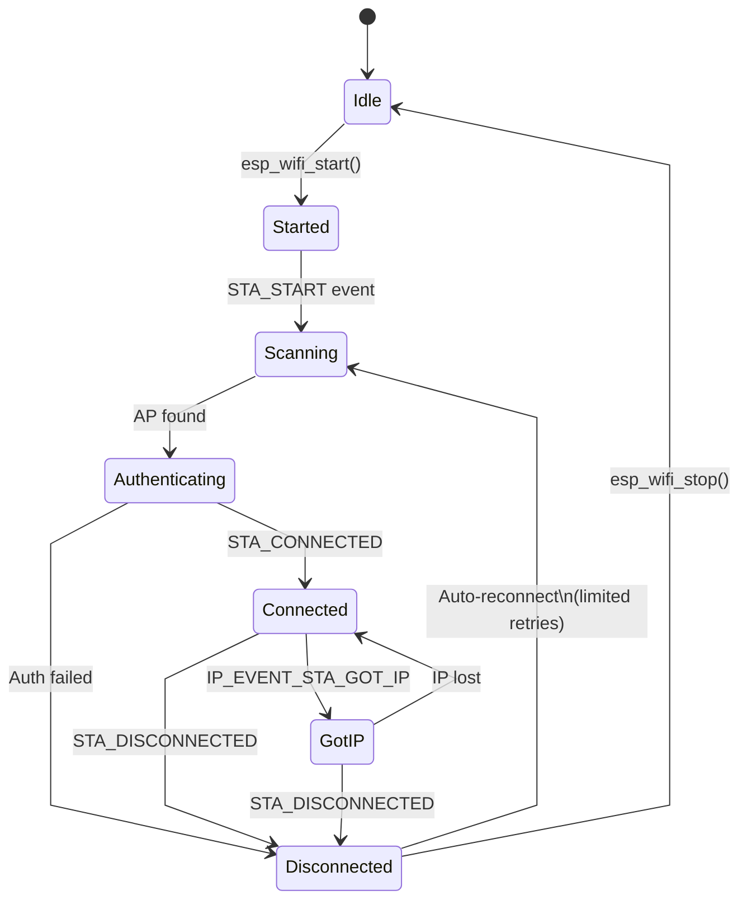

import TawkWidget from '../../../../components/TawkWidget.astro';
import UniversalContentContributors from '../../../../components/UniversalContentContributors.astro';
import InArticleAd from '../../../../components/InArticleAd.astro';
import Copyright from '../../../../components/Copyright.astro';
import BionicText from '../../../../components/BionicText.astro';
import TailwindWrapper from '../../../../components/TailwindWrapper.jsx';
import { Tabs, TabItem } from '@astrojs/starlight/components';
import { Card, CardGrid, Badge, Steps, LinkButton, FileTree } from '@astrojs/starlight/components';

<UniversalContentContributors 
  contributors={frontmatter.contributors}
/>


import EmbeddedProgrammingEsp32Comments from '../../../../components/embedded-programming-esp32/EmbeddedProgrammingEsp32Comments.astro';

A customer changes the router password, and every unit must come back to be programmed again, because the password was written into the firmware. Or the router restarts at night, and the device stops for good, because its code waited in a loop for a network that was not there. Wi-Fi fails often, and firmware must expect it. In this lesson you learn how the ESP32 reports what the network is doing, how it joins a network and how it makes its own, and how a phone can give it the password without a cable. The project is a signal mapper: it lists every Wi-Fi network in range with its strength and shows the list as a web page. #ESP32 #WiFi #Networking

## What We Are Building

<Card title="Wi-Fi Signal Mapper" icon="star">
A portable Wi-Fi survey tool. The ESP32 is at once a station (STA) on your own network and an access point (AP) with a small network of its own that a phone can join. Every 10 seconds it scans and records each network's name (SSID), signal strength (RSSI), channel and type of security. A web server on the ESP32 shows the list as a table.
</Card>

**Project specifications:**

| Parameter | Value |
|-----------|-------|
| MCU | ESP32 DevKitC |
| Wi-Fi Mode | STA+AP (simultaneous station and access point) |
| Scan Interval | Every 10 seconds (set by `SCAN_INTERVAL_MS`) |
| Data Collected | SSID, BSSID, RSSI (dBm), channel, auth mode |
| Max APs Tracked | 30 (sorted by signal strength) |
| Web Interface | HTTP server on port 80, auto-refresh HTML table |
| Provisioning | SmartConfig (first boot) or hardcoded fallback |
| Soft AP SSID | "ESP32-Mapper" (open, for local access) |
| New Parts Required | None |

### Bill of Materials

| Ref | Component | Quantity | Notes |
|-----|-----------|----------|-------|
| U1 | ESP32 DevKitC | 1 | The board you used for the lamp projects |
| | USB cable | 1 | For power and initial flashing |
| | Wi-Fi network | 1 | Any 2.4 GHz network for STA mode |

## Wi-Fi Driver Architecture

<InArticleAd />


Joining a network takes seconds and can fail at any step. If `esp_wifi_connect()` waited for the result, your whole program would stand still. So it only starts the work and returns at once. The result comes later as an event: a short message such as "connected", "disconnected" or "got an IP address".

It is like a food counter that gives you a number: you sit down, and your number is called. In ESP-IDF, the function that runs when your number is called is an event handler.

The Wi-Fi driver runs in its own task, created by `esp_wifi_init()`. Your code never touches the radio: it calls driver functions and receives events.

```text
 ┌──────────────────────────────────┐
 │  Your code                       │
 │  calls functions, handles events │
 ├──────────────────────────────────┤
 │  Event loop                      │
 │  carries WIFI_EVENT and IP_EVENT │
 ├──────────────────────────────────┤
 │  TCP/IP stack (lwIP)             │
 │  IP addresses, sockets, DNS      │
 ├──────────────────────────────────┤
 │  Wi-Fi driver                    │
 │  scan, join, security            │
 ├──────────────────────────────────┤
 │  Radio, 2.4 GHz                  │
 └──────────────────────────────────┘
```

### The Event Loop Model

The event loop is a task that takes events one at a time and calls the handlers registered for each. Every Wi-Fi program follows the same order:

1. Create the default event loop with `esp_event_loop_create_default()`.
2. Register handler functions for the events you need.
3. Initialize the Wi-Fi driver with `esp_wifi_init()`.
4. Set the mode (STA, AP, or both) and call `esp_wifi_start()`.
5. The driver posts events to the loop, and the loop calls your handlers.

The states below are the life of one station connection. "Connected" and "GotIP" differ: Connected means the radio link exists, and only after the router's DHCP service has given the device an IP address can it send data.



The shortest initialization:

```c
#include "esp_wifi.h"
#include "esp_event.h"
#include "nvs_flash.h"

/* Initialize NVS (required by the Wi-Fi driver for credential storage) */
esp_err_t ret = nvs_flash_init();
if (ret == ESP_ERR_NVS_NO_FREE_PAGES ||
    ret == ESP_ERR_NVS_NEW_VERSION_FOUND) {
    nvs_flash_erase();
    nvs_flash_init();
}

/* Initialize the TCP/IP stack */
esp_netif_init();

/* Create the default event loop */
esp_event_loop_create_default();

/* Create a default STA network interface */
esp_netif_create_default_wifi_sta();

/* Initialize the Wi-Fi driver with default config */
wifi_init_config_t cfg = WIFI_INIT_CONFIG_DEFAULT();
esp_wifi_init(&cfg);
```

`WIFI_INIT_CONFIG_DEFAULT()` fills in buffer sizes and task priorities.

### Event Handler Registration

Events come in families, named event bases. Two matter here: `WIFI_EVENT` for the state of the radio link and `IP_EVENT` for the IP address. A handler receives the event ID and a pointer to the data of that event:

```c
static void wifi_event_handler(void *arg, esp_event_base_t event_base,
                                int32_t event_id, void *event_data)
{
    if (event_base == WIFI_EVENT) {
        switch (event_id) {
            case WIFI_EVENT_STA_START:
                esp_wifi_connect();
                break;
            case WIFI_EVENT_STA_DISCONNECTED:
                esp_wifi_connect();  /* Auto-reconnect */
                break;
            default:
                break;
        }
    } else if (event_base == IP_EVENT) {
        if (event_id == IP_EVENT_STA_GOT_IP) {
            ip_event_got_ip_t *event = (ip_event_got_ip_t *)event_data;
            ESP_LOGI(TAG, "Got IP: " IPSTR, IP2STR(&event->ip_info.ip));
        }
    }
}

/* Register the handler for both event bases */
esp_event_handler_instance_t wifi_handler;
esp_event_handler_instance_t ip_handler;

esp_event_handler_instance_register(WIFI_EVENT, ESP_EVENT_ANY_ID,
                                     &wifi_event_handler, NULL, &wifi_handler);
esp_event_handler_instance_register(IP_EVENT, IP_EVENT_STA_GOT_IP,
                                     &wifi_event_handler, NULL, &ip_handler);
```

All handlers run one after another in the one event loop task, and while one runs every other event waits. So keep a handler short: set a flag, put a message in a queue, or call a quick driver function. Never wait or do long work in a handler.

## Station Mode (STA)

<InArticleAd />


In station mode the ESP32 joins an existing Wi-Fi network, as your phone does. Most connected devices work in this mode.

### Connecting to an Access Point

Give the driver the network name (SSID) and the password, then start Wi-Fi. The two strings below are placeholders:

```c
wifi_config_t wifi_sta_config = {
    .sta = {
        .ssid     = "YourNetworkSSID",
        .password = "YourNetworkPassword",
        .threshold.authmode = WIFI_AUTH_WPA2_PSK,
    },
};

esp_wifi_set_mode(WIFI_MODE_STA);
esp_wifi_set_config(WIFI_IF_STA, &wifi_sta_config);
esp_wifi_start();
```

After `esp_wifi_start()` the driver posts `WIFI_EVENT_STA_START`. Your handler answers with `esp_wifi_connect()`. If all goes well, two events follow:

1. `WIFI_EVENT_STA_CONNECTED`: the radio link to the access point exists.
2. `IP_EVENT_STA_GOT_IP`: the device has an IP address. Only now can it use the network.

### Auto-Reconnect Pattern

A Wi-Fi link drops when the router restarts, something blocks the signal, or the device moves out of range. The driver does not join again by itself. Your handler must ask, and count its attempts, so that a wrong password does not cause attempts without end:

```c
static int s_retry_count = 0;
#define MAX_RETRY 10

static void wifi_event_handler(void *arg, esp_event_base_t event_base,
                                int32_t event_id, void *event_data)
{
    if (event_base == WIFI_EVENT &&
        event_id == WIFI_EVENT_STA_DISCONNECTED) {

        wifi_event_sta_disconnected_t *disconn =
            (wifi_event_sta_disconnected_t *)event_data;
        ESP_LOGW(TAG, "Disconnected, reason=%d", disconn->reason);

        if (s_retry_count < MAX_RETRY) {
            esp_wifi_connect();
            s_retry_count++;
            ESP_LOGI(TAG, "Reconnect attempt %d/%d", s_retry_count, MAX_RETRY);
        } else {
            ESP_LOGE(TAG, "Max retries reached. Stopping reconnect.");
        }
    }

    if (event_base == IP_EVENT &&
        event_id == IP_EVENT_STA_GOT_IP) {
        s_retry_count = 0;  /* Reset counter on successful connection */
        ip_event_got_ip_t *event = (ip_event_got_ip_t *)event_data;
        ESP_LOGI(TAG, "Connected. IP: " IPSTR, IP2STR(&event->ip_info.ip));
    }
}
```

The event data has a `reason` field that says why the link dropped. Read it before you retry: a missing network may return, but a wrong password will fail every time.

A limit has a cost. A router that restarts at night is often off for a minute or more, and ten quick tries (about 2 s each) are used up in about 20 s, so the device stays offline until someone resets it. For a device that runs alone, do not stop for good when the network is missing: after the quick tries, wait longer between attempts (1, 2, 4 seconds and so on, up to about a minute) and keep trying.

### Common Disconnect Reasons

| Reason Code | Constant | Meaning |
|-------------|----------|---------|
| 2 | `WIFI_REASON_AUTH_EXPIRE` | Authentication timed out |
| 8 | `WIFI_REASON_ASSOC_LEAVE` | Station voluntarily left |
| 15 | `WIFI_REASON_4WAY_HANDSHAKE_TIMEOUT` | WPA handshake failed (wrong password) |
| 201 | `WIFI_REASON_NO_AP_FOUND` | SSID not found during scan |
| 202 | `WIFI_REASON_AUTH_FAIL` | Wrong password |

## Access Point Mode (AP)

<InArticleAd />


In AP mode the ESP32 makes its own Wi-Fi network for other devices to join: a soft AP, made in software with no router. Use it to set up a new device from a phone, or to show a web page where there is no router.

### Creating a Soft AP

```c
/* Create the default AP network interface */
esp_netif_create_default_wifi_ap();

wifi_config_t wifi_ap_config = {
    .ap = {
        .ssid           = "ESP32-Mapper",
        .ssid_len       = strlen("ESP32-Mapper"),
        .password       = "",              /* Open network */
        .max_connection = 4,
        .authmode       = WIFI_AUTH_OPEN,
        .channel        = 1,
    },
};

esp_wifi_set_mode(WIFI_MODE_AP);
esp_wifi_set_config(WIFI_IF_AP, &wifi_ap_config);
esp_wifi_start();
```

The soft AP also runs a DHCP server, the service that gives each device that joins an IP address. Devices get addresses of the form 192.168.4.x, and the ESP32 itself is 192.168.4.1.

This AP is open: it has no password, so anyone in range can join it and read the page. That is acceptable for a survey tool on your desk. A product needs a password on its AP.

### Client Tracking

Two events tell you when a device joins or leaves:

```c
static void ap_event_handler(void *arg, esp_event_base_t event_base,
                              int32_t event_id, void *event_data)
{
    if (event_id == WIFI_EVENT_AP_STACONNECTED) {
        wifi_event_ap_staconnected_t *event =
            (wifi_event_ap_staconnected_t *)event_data;
        ESP_LOGI(TAG, "Client connected, MAC=" MACSTR ", AID=%d",
                 MAC2STR(event->mac), event->aid);
    } else if (event_id == WIFI_EVENT_AP_STADISCONNECTED) {
        wifi_event_ap_stadisconnected_t *event =
            (wifi_event_ap_stadisconnected_t *)event_data;
        ESP_LOGI(TAG, "Client disconnected, MAC=" MACSTR, MAC2STR(event->mac));
    }
}
```

`max_connection` limits how many devices can join at once (up to 10).

## STA+AP Mode

<InArticleAd />


The ESP32 can be a station and an access point at the same time. The signal mapper uses this mode: the station side joins your network, and the AP side lets a phone or laptop connect directly to see the results.

```text
 ┌──────────┐       ┌──────────────┐
 │  Home    │  STA  │              │  AP
 │  Router  │<─────>│    ESP32     │<─────>┌────────┐
 │          │ .100  │              │ .1    │ Phone/ │
 └──────────┘       │ 192.168.4.1 │       │ Laptop │
 192.168.1.x        │              │       └────────┘
  (existing)        └──────────────┘     192.168.4.x
                     SSID: ESP32-Mapper   (ESP32 AP)
```

```c
/* Create both network interfaces */
esp_netif_create_default_wifi_sta();
esp_netif_create_default_wifi_ap();

/* Set mode to STA+AP */
esp_wifi_set_mode(WIFI_MODE_APSTA);

/* Configure STA */
wifi_config_t sta_config = {
    .sta = {
        .ssid     = "YourNetworkSSID",
        .password = "YourNetworkPassword",
    },
};
esp_wifi_set_config(WIFI_IF_STA, &sta_config);

/* Configure AP */
wifi_config_t ap_config = {
    .ap = {
        .ssid           = "ESP32-Mapper",
        .ssid_len       = strlen("ESP32-Mapper"),
        .password       = "",
        .max_connection = 4,
        .authmode       = WIFI_AUTH_OPEN,
        .channel        = 1,
    },
};
esp_wifi_set_config(WIFI_IF_AP, &ap_config);

/* Start both interfaces */
esp_wifi_start();
```

The two sides are two interfaces but one radio, which listens on one channel at a time, so the AP follows the station: if the station joins a router on channel 6, the AP moves to channel 6, whatever its configuration says. The `.channel` field of the AP applies only while the station is not connected. A phone on the AP may lose its link for a moment when this move happens.

## Wi-Fi Scanning

<InArticleAd />


The 2.4 GHz band is divided into channels, 1 to 13 in most countries. In an active scan the ESP32 visits each channel, asks "who is here?", and listens briefly for access points to answer; the listening time per channel is the dwell time.

### Scan API

A scan has two steps: start it, then fetch the results.

```c
/* Configure scan parameters */
wifi_scan_config_t scan_config = {
    .ssid        = NULL,         /* Scan for all SSIDs */
    .bssid       = NULL,         /* No BSSID filter */
    .channel     = 0,            /* Scan all channels */
    .show_hidden = true,         /* Include hidden networks */
    .scan_type   = WIFI_SCAN_TYPE_ACTIVE,
    .scan_time = {
        .active = {
            .min = 120,          /* Min dwell time per channel (ms) */
            .max = 150,          /* Max dwell time per channel (ms) */
        },
    },
};

/* Start a blocking scan */
esp_wifi_scan_start(&scan_config, true);

/* Get the number of APs found */
uint16_t ap_count = 0;
esp_wifi_scan_get_ap_num(&ap_count);

/* Allocate and retrieve the records */
wifi_ap_record_t *ap_records = malloc(sizeof(wifi_ap_record_t) * ap_count);
esp_wifi_scan_get_ap_records(&ap_count, ap_records);
```

With `true` as the second argument, `esp_wifi_scan_start()` waits until the scan is complete. With 13 channels and up to 150 ms on each, that is about 2 seconds, so call it from your own task and never from an event handler. With `false` the function returns at once, and a `WIFI_EVENT_SCAN_DONE` event arrives when the scan ends.

### Interpreting Scan Results

Each `wifi_ap_record_t` describes one access point:

| Field | Type | Description |
|-------|------|-------------|
| `ssid` | `uint8_t[33]` | Network name (null-terminated) |
| `bssid` | `uint8_t[6]` | MAC address of the access point |
| `rssi` | `int8_t` | Signal strength in dBm (typical: -30 strong, -90 weak) |
| `primary` | `uint8_t` | Primary channel number (1 to 13) |
| `authmode` | `wifi_auth_mode_t` | Encryption type |

The MAC address is the hardware address of the access point. Two access points can share one SSID, but each has its own BSSID. The `authmode` field is a number, and this function turns it into text:

```c
static const char *auth_mode_str(wifi_auth_mode_t authmode)
{
    switch (authmode) {
        case WIFI_AUTH_OPEN:            return "Open";
        case WIFI_AUTH_WEP:             return "WEP";
        case WIFI_AUTH_WPA_PSK:         return "WPA-PSK";
        case WIFI_AUTH_WPA2_PSK:        return "WPA2-PSK";
        case WIFI_AUTH_WPA_WPA2_PSK:    return "WPA/WPA2";
        case WIFI_AUTH_WPA3_PSK:        return "WPA3-PSK";
        case WIFI_AUTH_WPA2_WPA3_PSK:   return "WPA2/WPA3";
        case WIFI_AUTH_WAPI_PSK:        return "WAPI";
        default:                        return "Unknown";
    }
}
```

### RSSI Interpretation

RSSI (received signal strength indicator) is the power of the arriving signal in dBm, a logarithmic scale on which 0 dBm is 1 milliwatt. A received Wi-Fi signal is far weaker than 1 milliwatt, so the number is negative, and nearer to zero is stronger: -40 dBm is stronger than -70 dBm.

| RSSI Range | Signal Quality |
|------------|---------------|
| -30 to -50 | Excellent |
| -50 to -60 | Good |
| -60 to -70 | Fair |
| -70 to -80 | Weak |
| Below -80 | Very weak, unreliable |

On a logarithmic scale differences are ratios: 3 dB lower is about half the power, 10 dB lower is one tenth, and each further 10 dB divides by 10 again. An access point at -40 dBm delivers 100 times the power of one at -60 dBm.

## SmartConfig Provisioning

<InArticleAd />


Provisioning means giving a device the name and password of its network. A password in the firmware is fine while you develop, but a product must accept it at the place of use, with no keyboard. With SmartConfig, a phone app (Espressif's ESP-Touch) sends the name and password by radio to the ESP32.

### How SmartConfig Works

The ESP32 is not yet on the network, so the phone cannot send it a normal message. But the ESP32 can observe one thing from outside the network: the length of each packet. Think of sealed envelopes: you cannot read the letter, but you can measure the envelope.

The phone, already on the network, sends packets whose lengths spell out the SSID and password. The ESP32 listens to all Wi-Fi traffic in range (promiscuous mode), measures the lengths, and rebuilds the name and password from them.

```text
  Phone (app)          Router              ESP32
      │                   │                  │
      │ 1 packets whose   │                  │
      │   lengths carry   │  2 hears them,   │
      │   SSID + password │    reads lengths │
      ├──────────────────>│ ─ ─ ─ ─ ─ ─ ─ ─ >│
      │                   │                  │
      │                   │  3 joins the     │
      │                   │<─────────────────┤
      │                   │    network       │
      │ 4 "done" message  │                  │
      │<──────────────────┴──────────────────┤
```

### SmartConfig Implementation

```c
#include "esp_smartconfig.h"

static EventGroupHandle_t s_wifi_event_group;
#define CONNECTED_BIT    BIT0
#define ESPTOUCH_DONE_BIT BIT1

static void smartconfig_event_handler(void *arg, esp_event_base_t event_base,
                                       int32_t event_id, void *event_data)
{
    if (event_base == WIFI_EVENT &&
        event_id == WIFI_EVENT_STA_START) {
        /* Start SmartConfig when station starts */
        ESP_LOGI(TAG, "Starting SmartConfig...");
        esp_smartconfig_set_type(SC_TYPE_ESPTOUCH);
        smartconfig_start_config_t sc_cfg = SMARTCONFIG_START_CONFIG_DEFAULT();
        esp_smartconfig_start(&sc_cfg);
    }

    if (event_base == SC_EVENT &&
        event_id == SC_EVENT_GOT_SSID_PSWD) {
        smartconfig_event_got_ssid_pswd_t *evt =
            (smartconfig_event_got_ssid_pswd_t *)event_data;

        wifi_config_t wifi_config = {0};
        memcpy(wifi_config.sta.ssid, evt->ssid, sizeof(wifi_config.sta.ssid));
        memcpy(wifi_config.sta.password, evt->password,
               sizeof(wifi_config.sta.password));

        ESP_LOGI(TAG, "SmartConfig got SSID: %s", (char *)evt->ssid);

        esp_wifi_disconnect();
        esp_wifi_set_config(WIFI_IF_STA, &wifi_config);
        esp_wifi_connect();
    }

    if (event_base == SC_EVENT &&
        event_id == SC_EVENT_SEND_ACK_DONE) {
        ESP_LOGI(TAG, "SmartConfig ACK sent, provisioning complete");
        esp_smartconfig_stop();
        xEventGroupSetBits(s_wifi_event_group, ESPTOUCH_DONE_BIT);
    }
}
```

### Storing Credentials in NVS

The device must not ask for the password after every restart. `esp_wifi_set_config()` saves the configuration in NVS, the store of saved values in flash, and on the next boot the driver finds it there and joins without SmartConfig.

`esp_wifi_set_storage()` chooses where the configuration is kept:

```c
/* Store Wi-Fi config in flash (default behavior) */
esp_wifi_set_storage(WIFI_STORAGE_FLASH);

/* Or keep config in RAM only (lost on reboot) */
esp_wifi_set_storage(WIFI_STORAGE_RAM);
```

The signal mapper uses `WIFI_STORAGE_FLASH`.

## Simple HTTP Server for Results

<InArticleAd />


A browser asks for a page with an HTTP request, and a web server answers. ESP-IDF has a small one, `esp_http_server`, running as a FreeRTOS task. You register a handler function for each address (URI), and the server calls it when a browser asks for that address.

### Setting Up the Server

```c
#include "esp_http_server.h"

static httpd_handle_t server = NULL;

static esp_err_t root_get_handler(httpd_req_t *req)
{
    /* We will build the HTML response here */
    const char *html = "<html><body><h1>Wi-Fi Signal Mapper</h1></body></html>";
    httpd_resp_set_type(req, "text/html");
    httpd_resp_send(req, html, HTTPD_RESP_USE_STRLEN);
    return ESP_OK;
}

static const httpd_uri_t root_uri = {
    .uri       = "/",
    .method    = HTTP_GET,
    .handler   = root_get_handler,
    .user_ctx  = NULL,
};

static httpd_handle_t start_webserver(void)
{
    httpd_config_t config = HTTPD_DEFAULT_CONFIG();
    config.stack_size = 8192;

    if (httpd_start(&server, &config) == ESP_OK) {
        httpd_register_uri_handler(server, &root_uri);
        ESP_LOGI(TAG, "HTTP server started on port %d", config.server_port);
    }
    return server;
}
```

`HTTPD_DEFAULT_CONFIG()` makes the server listen on port 80, the standard port for web pages, with at most 7 connections at once. The stack of 8192 bytes leaves room to build the page.

### Sending Chunked Responses

A table of 30 access points is several kilobytes of HTML, too much to build in one buffer. A chunked response sends the page in pieces, using one small buffer again for each row:

```c
static esp_err_t root_get_handler(httpd_req_t *req)
{
    httpd_resp_set_type(req, "text/html");

    /* Send the HTML header */
    httpd_resp_sendstr_chunk(req, "<!DOCTYPE html><html><head>"
        "<meta http-equiv='refresh' content='10'>"
        "<title>Wi-Fi Mapper</title></head><body>");

    /* Send table rows in a loop */
    char line[256];
    for (int i = 0; i < ap_count; i++) {
        snprintf(line, sizeof(line),
                 "<tr><td>%s</td><td>%d</td><td>%d</td></tr>",
                 (char *)ap_list[i].ssid,
                 ap_list[i].rssi,
                 ap_list[i].primary);
        httpd_resp_sendstr_chunk(req, line);
    }

    /* End the response */
    httpd_resp_sendstr_chunk(req, "</body></html>");
    httpd_resp_sendstr_chunk(req, NULL);  /* Signal end of chunks */
    return ESP_OK;
}
```

The `<meta http-equiv='refresh' content='10'>` tag tells the browser to load the page again every 10 seconds.

## Complete Firmware

<InArticleAd />


This is the complete `main.c`: STA+AP mode, a scan every 10 seconds, and a web page with the results.

```c
/* main.c -- Wi-Fi Signal Mapper
 *
 * ESP-IDF v5.x project.
 * Runs in STA+AP mode. The STA interface connects to your home network;
 * the AP interface ("ESP32-Mapper") lets any device connect directly.
 * Performs periodic Wi-Fi scans and serves results as an HTML table on port 80.
 */

#include <string.h>
#include <stdlib.h>
#include "freertos/FreeRTOS.h"
#include "freertos/task.h"
#include "freertos/event_groups.h"
#include "freertos/semphr.h"
#include "esp_system.h"
#include "esp_wifi.h"
#include "esp_event.h"
#include "esp_log.h"
#include "esp_netif.h"
#include "esp_http_server.h"
#include "esp_smartconfig.h"
#include "nvs_flash.h"

/* ---------- Configuration ---------- */

static const char *TAG = "wifi_mapper";

#define MAX_AP_RECORDS       30
#define SCAN_INTERVAL_MS     10000
#define AP_SSID              "ESP32-Mapper"
#define AP_MAX_CONN          4

/* STA credentials: set via menuconfig or SmartConfig */
#define DEFAULT_STA_SSID     CONFIG_WIFI_SSID
#define DEFAULT_STA_PASS     CONFIG_WIFI_PASSWORD

/* ---------- Global state ---------- */

static EventGroupHandle_t s_wifi_event_group;
#define STA_CONNECTED_BIT    BIT0
#define STA_GOT_IP_BIT       BIT1
#define SMARTCONFIG_DONE_BIT BIT2

static wifi_ap_record_t s_ap_records[MAX_AP_RECORDS];
static uint16_t s_ap_count = 0;
static SemaphoreHandle_t s_scan_mutex;
static httpd_handle_t s_server = NULL;
static int s_retry_count = 0;
#define MAX_RETRY 5

/* ---------- Auth mode to string ---------- */

static const char *auth_mode_str(wifi_auth_mode_t authmode)
{
    switch (authmode) {
        case WIFI_AUTH_OPEN:            return "Open";
        case WIFI_AUTH_WEP:             return "WEP";
        case WIFI_AUTH_WPA_PSK:         return "WPA";
        case WIFI_AUTH_WPA2_PSK:        return "WPA2";
        case WIFI_AUTH_WPA_WPA2_PSK:    return "WPA/WPA2";
        case WIFI_AUTH_WPA3_PSK:        return "WPA3";
        case WIFI_AUTH_WPA2_WPA3_PSK:   return "WPA2/WPA3";
        case WIFI_AUTH_WAPI_PSK:        return "WAPI";
        default:                        return "Unknown";
    }
}

/* ---------- RSSI to signal bar string ---------- */

static const char *rssi_bar(int8_t rssi)
{
    if (rssi >= -50) return "&#9608;&#9608;&#9608;&#9608;&#9608;";
    if (rssi >= -60) return "&#9608;&#9608;&#9608;&#9608;";
    if (rssi >= -70) return "&#9608;&#9608;&#9608;";
    if (rssi >= -80) return "&#9608;&#9608;";
    return "&#9608;";
}

/* ---------- Event handlers ---------- */

static void wifi_event_handler(void *arg, esp_event_base_t event_base,
                                int32_t event_id, void *event_data)
{
    if (event_base == WIFI_EVENT) {
        switch (event_id) {
            case WIFI_EVENT_STA_START:
                ESP_LOGI(TAG, "STA started, connecting...");
                esp_wifi_connect();
                break;

            case WIFI_EVENT_STA_CONNECTED:
                ESP_LOGI(TAG, "STA connected to AP");
                xEventGroupSetBits(s_wifi_event_group, STA_CONNECTED_BIT);
                break;

            case WIFI_EVENT_STA_DISCONNECTED: {
                wifi_event_sta_disconnected_t *d =
                    (wifi_event_sta_disconnected_t *)event_data;
                ESP_LOGW(TAG, "STA disconnected, reason=%d", d->reason);
                xEventGroupClearBits(s_wifi_event_group,
                                     STA_CONNECTED_BIT | STA_GOT_IP_BIT);
                if (s_retry_count < MAX_RETRY) {
                    esp_wifi_connect();
                    s_retry_count++;
                    ESP_LOGI(TAG, "Reconnect attempt %d/%d",
                             s_retry_count, MAX_RETRY);
                } else {
                    ESP_LOGE(TAG, "Max retries reached");
                }
                break;
            }

            case WIFI_EVENT_AP_STACONNECTED: {
                wifi_event_ap_staconnected_t *e =
                    (wifi_event_ap_staconnected_t *)event_data;
                ESP_LOGI(TAG, "AP client connected, MAC=" MACSTR,
                         MAC2STR(e->mac));
                break;
            }

            case WIFI_EVENT_AP_STADISCONNECTED: {
                wifi_event_ap_stadisconnected_t *e =
                    (wifi_event_ap_stadisconnected_t *)event_data;
                ESP_LOGI(TAG, "AP client disconnected, MAC=" MACSTR,
                         MAC2STR(e->mac));
                break;
            }

            default:
                break;
        }
    }

    if (event_base == IP_EVENT && event_id == IP_EVENT_STA_GOT_IP) {
        ip_event_got_ip_t *event = (ip_event_got_ip_t *)event_data;
        ESP_LOGI(TAG, "Got IP: " IPSTR, IP2STR(&event->ip_info.ip));
        s_retry_count = 0;
        xEventGroupSetBits(s_wifi_event_group, STA_GOT_IP_BIT);
    }
}

static void smartconfig_event_handler(void *arg, esp_event_base_t event_base,
                                       int32_t event_id, void *event_data)
{
    if (event_id == SC_EVENT_GOT_SSID_PSWD) {
        smartconfig_event_got_ssid_pswd_t *evt =
            (smartconfig_event_got_ssid_pswd_t *)event_data;

        wifi_config_t wifi_config = {0};
        memcpy(wifi_config.sta.ssid, evt->ssid,
               sizeof(wifi_config.sta.ssid));
        memcpy(wifi_config.sta.password, evt->password,
               sizeof(wifi_config.sta.password));

        ESP_LOGI(TAG, "SmartConfig SSID: %s", (char *)evt->ssid);

        s_retry_count = 0;   /* the new network gets its own retries */
        esp_wifi_disconnect();
        esp_wifi_set_config(WIFI_IF_STA, &wifi_config);
        esp_wifi_connect();
    }

    if (event_id == SC_EVENT_SEND_ACK_DONE) {
        ESP_LOGI(TAG, "SmartConfig ACK done");
        esp_smartconfig_stop();
        xEventGroupSetBits(s_wifi_event_group, SMARTCONFIG_DONE_BIT);
    }
}

/* ---------- Wi-Fi initialization ---------- */

static void wifi_init(void)
{
    s_wifi_event_group = xEventGroupCreate();
    s_scan_mutex = xSemaphoreCreateMutex();

    /* TCP/IP and event loop */
    esp_netif_init();
    esp_event_loop_create_default();

    /* Create both STA and AP interfaces */
    esp_netif_create_default_wifi_sta();
    esp_netif_create_default_wifi_ap();

    /* Initialize the Wi-Fi driver */
    wifi_init_config_t cfg = WIFI_INIT_CONFIG_DEFAULT();
    esp_wifi_init(&cfg);

    /* Store config in flash so it persists across reboots */
    esp_wifi_set_storage(WIFI_STORAGE_FLASH);

    /* Register event handlers */
    esp_event_handler_instance_register(WIFI_EVENT, ESP_EVENT_ANY_ID,
                                         &wifi_event_handler, NULL, NULL);
    esp_event_handler_instance_register(IP_EVENT, IP_EVENT_STA_GOT_IP,
                                         &wifi_event_handler, NULL, NULL);
    esp_event_handler_instance_register(SC_EVENT, ESP_EVENT_ANY_ID,
                                         &smartconfig_event_handler, NULL, NULL);

    /* Set STA+AP mode */
    esp_wifi_set_mode(WIFI_MODE_APSTA);

    /* Configure STA. Use the menuconfig network only when flash holds
       none yet: setting it at every boot would overwrite the network
       that SmartConfig saved. */
    wifi_config_t sta_config = {0};
    esp_wifi_get_config(WIFI_IF_STA, &sta_config);
    if (sta_config.sta.ssid[0] == '\0') {
        strlcpy((char *)sta_config.sta.ssid, DEFAULT_STA_SSID,
                sizeof(sta_config.sta.ssid));
        strlcpy((char *)sta_config.sta.password, DEFAULT_STA_PASS,
                sizeof(sta_config.sta.password));
        sta_config.sta.threshold.authmode = WIFI_AUTH_WPA2_PSK;
        esp_wifi_set_config(WIFI_IF_STA, &sta_config);
    }

    /* Configure AP */
    wifi_config_t ap_config = {
        .ap = {
            .ssid           = AP_SSID,
            .ssid_len       = strlen(AP_SSID),
            .password       = "",
            .max_connection = AP_MAX_CONN,
            .authmode       = WIFI_AUTH_OPEN,
        },
    };
    esp_wifi_set_config(WIFI_IF_AP, &ap_config);

    /* Start Wi-Fi */
    esp_wifi_start();

    ESP_LOGI(TAG, "Wi-Fi initialized in STA+AP mode");
    ESP_LOGI(TAG, "AP SSID: %s (open, connect to access web UI)", AP_SSID);
}

/* ---------- Scan task ---------- */

static void scan_task(void *pvParameters)
{
    /* Wait briefly for Wi-Fi to fully start */
    vTaskDelay(pdMS_TO_TICKS(3000));

    ESP_LOGI(TAG, "Scan task started on core %d", xPortGetCoreID());

    while (1) {
        wifi_scan_config_t scan_cfg = {
            .ssid        = NULL,
            .bssid       = NULL,
            .channel     = 0,
            .show_hidden = true,
            .scan_type   = WIFI_SCAN_TYPE_ACTIVE,
            .scan_time = {
                .active = { .min = 120, .max = 150 },
            },
        };

        esp_err_t err = esp_wifi_scan_start(&scan_cfg, true);
        if (err != ESP_OK) {
            ESP_LOGW(TAG, "Scan failed: %s", esp_err_to_name(err));
            vTaskDelay(pdMS_TO_TICKS(SCAN_INTERVAL_MS));
            continue;
        }

        uint16_t count = 0;
        esp_wifi_scan_get_ap_num(&count);
        if (count > MAX_AP_RECORDS) {
            count = MAX_AP_RECORDS;
        }

        /* static: 30 records are too large for the 4096-byte task stack */
        static wifi_ap_record_t temp[MAX_AP_RECORDS];
        esp_wifi_scan_get_ap_records(&count, temp);

        /* Sort by RSSI descending (strongest first) */
        for (int i = 0; i + 1 < count; i++) {
            for (int j = i + 1; j < count; j++) {
                if (temp[j].rssi > temp[i].rssi) {
                    wifi_ap_record_t swap = temp[i];
                    temp[i] = temp[j];
                    temp[j] = swap;
                }
            }
        }

        /* Copy results under mutex protection */
        if (xSemaphoreTake(s_scan_mutex, pdMS_TO_TICKS(1000)) == pdTRUE) {
            memcpy(s_ap_records, temp, sizeof(wifi_ap_record_t) * count);
            s_ap_count = count;
            xSemaphoreGive(s_scan_mutex);
        }

        ESP_LOGI(TAG, "Scan complete: %d APs found", count);

        vTaskDelay(pdMS_TO_TICKS(SCAN_INTERVAL_MS));
    }
}

/* ---------- HTTP server ---------- */

static esp_err_t root_get_handler(httpd_req_t *req)
{
    httpd_resp_set_type(req, "text/html");

    /* HTML head with auto-refresh and embedded CSS */
    httpd_resp_sendstr_chunk(req,
        "<!DOCTYPE html><html><head>"
        "<meta charset='UTF-8'>"
        "<meta http-equiv='refresh' content='10'>"
        "<meta name='viewport' content='width=device-width, initial-scale=1'>"
        "<title>Wi-Fi Signal Mapper</title>"
        "<style>"
        "body { font-family: 'Segoe UI', Arial, sans-serif; margin: 20px;"
        "  background: #f5f5f5; color: #333; }"
        "h1 { color: #2c3e50; margin-bottom: 5px; }"
        "p.info { color: #666; font-size: 14px; margin-top: 0; }"
        "table { border-collapse: collapse; width: 100%;"
        "  background: white; box-shadow: 0 1px 3px rgba(0,0,0,0.12); }"
        "th { background: #2c3e50; color: white; padding: 12px 15px;"
        "  text-align: left; font-size: 14px; }"
        "td { padding: 10px 15px; border-bottom: 1px solid #eee;"
        "  font-size: 14px; }"
        "tr:hover { background: #f0f7ff; }"
        ".rssi-excellent { color: #27ae60; font-weight: bold; }"
        ".rssi-good { color: #2ecc71; }"
        ".rssi-fair { color: #f39c12; }"
        ".rssi-weak { color: #e74c3c; }"
        ".bar { font-size: 10px; letter-spacing: -1px; }"
        "</style></head><body>");

    httpd_resp_sendstr_chunk(req,
        "<h1>Wi-Fi Signal Mapper</h1>"
        "<p class='info'>Page refreshes every 10 seconds. ");

    /* Show AP count */
    char info[128];
    if (xSemaphoreTake(s_scan_mutex, pdMS_TO_TICKS(500)) == pdTRUE) {
        snprintf(info, sizeof(info),
                 "Detected <strong>%d</strong> access point%s.</p>",
                 s_ap_count, s_ap_count == 1 ? "" : "s");
        httpd_resp_sendstr_chunk(req, info);

        /* Table header */
        httpd_resp_sendstr_chunk(req,
            "<table><thead><tr>"
            "<th>#</th>"
            "<th>SSID</th>"
            "<th>BSSID</th>"
            "<th>Channel</th>"
            "<th>RSSI (dBm)</th>"
            "<th>Signal</th>"
            "<th>Auth</th>"
            "</tr></thead><tbody>");

        /* Table rows */
        for (int i = 0; i < s_ap_count; i++) {
            const char *css_class;
            if (s_ap_records[i].rssi >= -50)      css_class = "rssi-excellent";
            else if (s_ap_records[i].rssi >= -60)  css_class = "rssi-good";
            else if (s_ap_records[i].rssi >= -70)  css_class = "rssi-fair";
            else                                    css_class = "rssi-weak";

            /* Handle hidden SSIDs */
            const char *ssid = (char *)s_ap_records[i].ssid;
            if (ssid[0] == '\0') {
                ssid = "(hidden)";
            }

            char row[512];
            snprintf(row, sizeof(row),
                "<tr>"
                "<td>%d</td>"
                "<td><strong>%s</strong></td>"
                "<td>" MACSTR "</td>"
                "<td>%d</td>"
                "<td class='%s'>%d</td>"
                "<td class='bar %s'>%s</td>"
                "<td>%s</td>"
                "</tr>",
                i + 1,
                ssid,
                MAC2STR(s_ap_records[i].bssid),
                s_ap_records[i].primary,
                css_class, s_ap_records[i].rssi,
                css_class, rssi_bar(s_ap_records[i].rssi),
                auth_mode_str(s_ap_records[i].authmode));

            httpd_resp_sendstr_chunk(req, row);
        }

        xSemaphoreGive(s_scan_mutex);
    } else {
        httpd_resp_sendstr_chunk(req,
            "Scan data temporarily unavailable.</p>");
    }

    httpd_resp_sendstr_chunk(req, "</tbody></table></body></html>");
    httpd_resp_sendstr_chunk(req, NULL);  /* End chunked response */
    return ESP_OK;
}

static void start_webserver(void)
{
    httpd_config_t config = HTTPD_DEFAULT_CONFIG();
    config.stack_size = 8192;

    if (httpd_start(&s_server, &config) == ESP_OK) {
        httpd_uri_t root = {
            .uri       = "/",
            .method    = HTTP_GET,
            .handler   = root_get_handler,
            .user_ctx  = NULL,
        };
        httpd_register_uri_handler(s_server, &root);
        ESP_LOGI(TAG, "HTTP server started on port 80");
    } else {
        ESP_LOGE(TAG, "Failed to start HTTP server");
    }
}

/* ---------- SmartConfig task ---------- */

static void smartconfig_task(void *pvParameters)
{
    /* Only run SmartConfig if no stored credentials exist.
     * We check by waiting a few seconds for the STA to connect. */
    EventBits_t bits = xEventGroupWaitBits(s_wifi_event_group,
                                            STA_GOT_IP_BIT,
                                            false, false,
                                            pdMS_TO_TICKS(15000));

    if (bits & STA_GOT_IP_BIT) {
        ESP_LOGI(TAG, "STA connected, SmartConfig not needed");
        vTaskDelete(NULL);
        return;
    }

    ESP_LOGI(TAG, "STA not connected, starting SmartConfig...");
    ESP_LOGI(TAG, "Use the ESP-Touch app to send credentials");

    esp_smartconfig_set_type(SC_TYPE_ESPTOUCH);
    smartconfig_start_config_t sc_cfg = SMARTCONFIG_START_CONFIG_DEFAULT();
    esp_smartconfig_start(&sc_cfg);

    /* Wait for SmartConfig to complete or STA to connect */
    xEventGroupWaitBits(s_wifi_event_group,
                        STA_GOT_IP_BIT | SMARTCONFIG_DONE_BIT,
                        false, false, portMAX_DELAY);

    ESP_LOGI(TAG, "SmartConfig task done");
    vTaskDelete(NULL);
}

/* ---------- Entry point ---------- */

void app_main(void)
{
    ESP_LOGI(TAG, "Wi-Fi Signal Mapper starting");

    /* Initialize NVS */
    esp_err_t ret = nvs_flash_init();
    if (ret == ESP_ERR_NVS_NO_FREE_PAGES ||
        ret == ESP_ERR_NVS_NEW_VERSION_FOUND) {
        nvs_flash_erase();
        nvs_flash_init();
    }

    /* Initialize Wi-Fi in STA+AP mode */
    wifi_init();

    /* Start the HTTP server immediately (AP is already up) */
    start_webserver();

    /* Start the scanning task */
    xTaskCreatePinnedToCore(scan_task, "scan_task", 4096,
                            NULL, 5, NULL, 0);

    /* Start SmartConfig fallback task */
    xTaskCreate(smartconfig_task, "smartconfig_task", 4096,
                NULL, 3, NULL);

    ESP_LOGI(TAG, "Initialization complete");
    ESP_LOGI(TAG, "Connect to AP '%s' and open http://192.168.4.1", AP_SSID);
}
```

### How the Firmware Works

The firmware has five parts:

1. `wifi_init` creates both interfaces, registers the handlers, sets STA+AP mode and starts the driver. It first reads the network saved in flash (`esp_wifi_get_config()`). Only if there is none does it use the name and password from menuconfig, so a network delivered by SmartConfig survives a restart. The AP "ESP32-Mapper" starts at once.

2. Two event handlers receive all Wi-Fi, IP and SmartConfig events. They reconnect up to 5 times, log devices that join the AP, and apply the name and password that SmartConfig delivers.

3. `scan_task` runs in its own task, so its 2 second scan blocks nothing else. Every 10 seconds it scans, sorts the results with the strongest first, and copies them into a shared buffer.

4. The HTTP server answers at `/` on port 80. Its handler reads the shared buffer and sends the table. It puts each network name into the page as it is. A network name is chosen by whoever owns that network, and a name such as `<b>x` would change your page. Before you leave the mapper on a site, replace `<`, `>`, `&` and `'` in each name with `&lt;`, `&gt;`, `&amp;` and `&#39;`.

5. The SmartConfig task waits 15 seconds for the station to connect. If it connects, the task ends. If not, it starts SmartConfig and waits for the ESP-Touch app.

### Thread Safety

The scan task writes the shared buffer and the HTTP handler, a different task, reads it. Without protection, a page asked for in the middle of a copy gets half old and half new rows. A mutex is a lock that one task holds at a time: each task takes `s_scan_mutex` before it touches the buffer and gives it back after, for a short copy or read only, so neither waits long.

## CMakeLists.txt and Kconfig Files

<InArticleAd />


### Top-Level CMakeLists.txt

```cmake
cmake_minimum_required(VERSION 3.16)
include($ENV{IDF_PATH}/tools/cmake/project.cmake)
project(wifi-signal-mapper)
```

### main/CMakeLists.txt

```cmake
idf_component_register(SRCS "main.c"
                       INCLUDE_DIRS ".")
```

### main/Kconfig.projbuild

This file adds your own entries to menuconfig, so the SSID and password never appear in the source code. The defaults are placeholders; the real values go into `sdkconfig`, which stays out of version control.

```
menu "Wi-Fi Signal Mapper Configuration"

    config WIFI_SSID
        string "Wi-Fi SSID"
        default "myssid"
        help
            SSID of the access point to connect to in station mode.

    config WIFI_PASSWORD
        string "Wi-Fi Password"
        default "mypassword"
        help
            Password for the access point.

endmenu
```

### Project File Structure

<FileTree>
- wifi-signal-mapper/
  - CMakeLists.txt
  - main/
    - CMakeLists.txt
    - Kconfig.projbuild
    - main.c
</FileTree>

## Building and Flashing

<InArticleAd />


<Steps>
1. Create the project directory and add all four files:
   ```bash
   mkdir -p wifi-signal-mapper/main
   ```
   Place the top-level `CMakeLists.txt` in `wifi-signal-mapper/`, and place `CMakeLists.txt`, `Kconfig.projbuild`, and `main.c` in `wifi-signal-mapper/main/`.

2. Set the target chip:
   ```bash
   cd wifi-signal-mapper
   idf.py set-target esp32
   ```

3. Configure your Wi-Fi credentials using menuconfig:
   ```bash
   idf.py menuconfig
   ```
   Navigate to **Wi-Fi Signal Mapper Configuration** and enter your network's SSID and password. Save and exit.

4. Build the project:
   ```bash
   idf.py build
   ```

5. Connect the ESP32 DevKitC via USB and flash:
   ```bash
   idf.py -p /dev/ttyUSB0 flash monitor
   ```
   On macOS use `/dev/cu.usbserial-XXXX` or `/dev/cu.SLAB_USBtoUART`. On Windows use `COM3` or the appropriate port.

6. Watch the serial output for connection status:
   ```
   I (456) wifi_mapper: Wi-Fi Signal Mapper starting
   I (742) wifi_mapper: STA started, connecting...
   I (745) wifi_mapper: Wi-Fi initialized in STA+AP mode
   I (746) wifi_mapper: AP SSID: ESP32-Mapper (open, connect to access web UI)
   I (752) wifi_mapper: HTTP server started on port 80
   I (753) wifi_mapper: Initialization complete
   I (754) wifi_mapper: Connect to AP 'ESP32-Mapper' and open http://192.168.4.1
   I (1980) wifi_mapper: STA connected to AP
   I (2890) wifi_mapper: Got IP: 192.168.1.105
   I (3753) wifi_mapper: Scan task started on core 0
   I (5870) wifi_mapper: Scan complete: 12 APs found
   ```

7. View the results from a phone or laptop:
   - Connect to the "ESP32-Mapper" Wi-Fi network (no password).
   - Open a browser and go to `http://192.168.4.1`.
   - You should see an HTML table listing all detected access points with SSID, BSSID, channel, RSSI, signal bars, and auth mode.
   - The page refreshes automatically every 10 seconds.

8. If the STA does not connect (wrong credentials or network not available):
   - Install the Espressif ESP-Touch app on your phone (available for iOS and Android).
   - After 15 seconds, the serial log will show "STA not connected, starting SmartConfig..."
   - Open the ESP-Touch app, enter your Wi-Fi password, and tap "Confirm".
   - The ESP32 will receive the credentials, connect, and store them in flash for future boots.

9. Press `Ctrl+]` to exit the serial monitor.
</Steps>

### Check it

A survey tool is only useful if its numbers agree with another instrument.

1. **Against a phone.** Stand still with the board and a phone side by side, and open a Wi-Fi analyser app on the phone. Each network should appear in both lists on the same channel, with an RSSI within about 10 dB (the two antennas differ). A network that the ESP32 never shows is often on 5 GHz, which the ESP32 cannot hear.
2. **Against distance.** Note the RSSI of your own router at 1 m, then at 4 m in open space. Four times the distance spreads the power over 16 times the area, so expect about 12 dB less (more through walls). A reading that does not change with distance means the page is not being refreshed.
3. **Against a lost network.** Switch the router off for two minutes and on again. The log shows `reason=` codes, then the retries; with this firmware's 5 quick tries the station gives up, which is the limit the auto-reconnect section warns about. If you used SmartConfig, restart the board and check that it joins the network the phone gave it, not the one from menuconfig.

## Exercises

<InArticleAd />


1. **Add a JSON API endpoint.** Register a second URI handler at `/api/scan` that returns the results as a JSON array, each element with `ssid`, `bssid`, `rssi`, `channel` and `auth`. Use `httpd_resp_set_type(req, "application/json")`, build the string with `snprintf`, and test with `curl http://192.168.4.1/api/scan`.

2. **Implement scan history tracking.** Keep the last 5 scan results for each BSSID (a ring buffer per AP). Add a `/history` endpoint with a small table per AP of its RSSI over the last 5 scans, so you see whether the signal improves or worsens as you walk around.

3. **Add WPA2 security to the soft AP.** Use `WIFI_AUTH_WPA2_PSK` with a password from a new Kconfig entry, `CONFIG_AP_PASSWORD`, with a default value. Check that devices without the password cannot connect, and note that the DHCP server behaves as before.

4. **Build a channel utilization chart.** After each scan, count the APs on each channel (1 to 13). Add a `/channels` endpoint that draws a horizontal bar chart in HTML and inline CSS, each bar as wide as its number of APs. It shows the least crowded channel for your own network.

## Summary

<InArticleAd />


- Wi-Fi functions start work and return. The result arrives later as an event, and the device can use the network only after `IP_EVENT_STA_GOT_IP`.
- All handlers share one task: keep them short, and do long work such as a scan in your own task.
- The driver does not reconnect by itself. Reconnect in the handler, count the attempts, and read the reason.
- In STA+AP mode there is one radio, so the AP uses the station's channel.
- RSSI is in dBm: nearer to zero is stronger, and 10 dB less is one tenth of the power.
- SmartConfig delivers the name and password from a phone, and the driver saves them in NVS.
- Data shared by two tasks needs a mutex.

<EmbeddedProgrammingEsp32Comments />


<InArticleAd />
<TawkWidget />
<Copyright />
